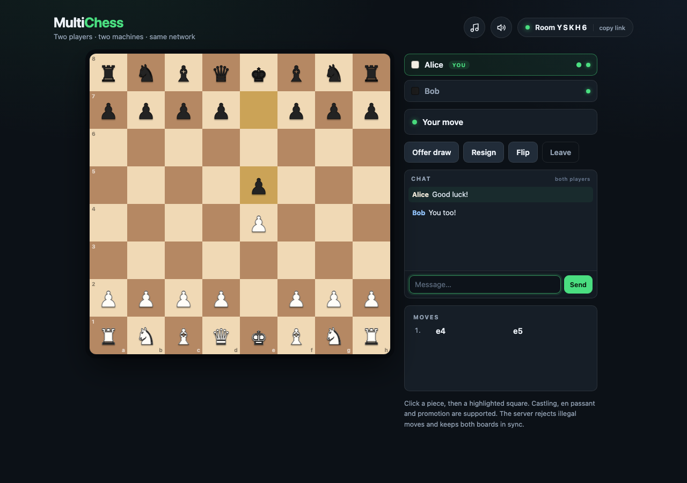

# MultiChess

Chess for your local network and against the computer. One machine runs a small
Node server; two players open the printed address in a browser and share a board
with real-time chat, or you can play solo against the built-in engine. No
accounts, no internet matchmaking, and no npm dependencies.



## Features

- Two-player LAN games with room codes and invite links.
- Single-player games with **Easy**, **Medium**, and **Hard** computer levels.
- **Normal** games with no clock and **Blitz** games with ten minutes per player.
- Live **Evaluation Bar** alongside the board, powered by the open-source **Lozza 11** UCI engine in a Web Worker.
- Server-authoritative rules and clocks, live SSE updates, and automatic reconnects.
- Real-time chat, draw offers, resignation, and rematches.
- Generated move/chat sounds and ambient music — no audio files.
- Zero npm dependencies; Node.js 18+ is all you need.

## Requirements

- [Node.js](https://nodejs.org/) 18 or newer on the machine that hosts the game.
- Two devices on the same Wi-Fi / LAN.
- A modern browser on each device.

The other machine does **not** need Node — only the host runs the server.

## Run it

From this folder:

```sh
cd multichess
node server.js
```

or, equivalently:

```sh
npm start
```

The server prints something like:

```
  MultiChess is running
  ---------------------
  Local:   http://localhost:8080
  Network (en0): http://192.168.1.42:8080   <- open on the other machine

  Both machines must be on the same Wi-Fi / network.
```

Open the **Network** address on both machines. If port 8080 is taken, pick
another one:

```sh
node server.js --port 8081
# or
PORT=8081 node server.js
```

If the other machine cannot connect, allow Node through the host's firewall
(macOS: System Settings → Network → Firewall) and make sure both devices are on
the same network and not on a guest/AP-isolated SSID.

## How to play

### Single player

Click **Play Single Player** on the opening screen to play White against the
computer opponent, powered by the open-source **Lozza 11** UCI chess engine.
Pick a difficulty first:

- **Easy** — Depth 1 evaluation (~1000 Elo); fast and friendly for beginners.
- **Medium** — Depth 4 search (~1600 Elo); solid tactical play that spots standard combinations.
- **Hard** — Depth 8 search (~2100+ Elo); deep positional and tactical calculations that punish inaccuracies.

The engine executes in a background **Web Worker** thread, so searches never lag the UI, clocks, or audio. If Web Workers are disabled or unavailable in the client environment, the game seamlessly falls back to the built-in minimax engine.

The choice is remembered in `localStorage` and is shown next to the computer's
name in the player panel.

After choosing single-player, pick a time control:

- **Normal** — no clock; take as long as you like.
- **Blitz** — ten minutes per player; the clock runs only on the side to move.

### Time controls

Every new game starts with a time-control choice:

- **Normal** has no clock and games can last as long as they need.
- **Blitz** gives each player **10 minutes**. White's clock starts when the game
  begins and each player's clock runs only on their turn. A player whose time
  reaches zero loses immediately.

In multiplayer the server owns the clock, so both players see the same time and
timeouts are enforced even if a browser is closed. Rematches reset both clocks
to 10:00. The player who creates the room chooses the time control; anyone who
joins inherits it.

### Online

1. On the host machine, open the Network address and choose **Play Multiplayer**,
   then pick **Normal** or **Blitz**.
   You are **White**.
2. Share the 5-character room code or the invite link with the other player.
   The second machine opens the same address, enters the code, and clicks
   **Join**. They are **Black**.
3. White moves first. Click a piece, then click a highlighted square.
4. Use **Offer draw**, **Resign**, **Flip**, and **Rematch** as needed.

Both boards are kept in sync by the server. Refreshing the page reconnects you
to your seat automatically — the session is remembered in `localStorage`.

### Invite links

The **Copy invite link** button copies a URL with the room code, for example
`http://192.168.1.42:8080/?room=K7QP2`. The code is prefilled; enter a name and
click **Join**.

A resume link with a player token (`?room=CODE&token=...`) can restore a seat
manually. The app removes the token from the address bar after loading and keeps
it in `localStorage` instead.

## Rules supported

- Full legal move generation — you cannot leave your own king in check.
- Castling (both sides, with all legality restrictions).
- En passant.
- Promotion to queen, rook, bishop, or knight.
- Check, checkmate, and stalemate detection.
- Standard algebraic notation (SAN) move history.
- Draw offers, resignation, and rematches. Colors stay fixed on rematch.
- Optional Blitz clocks: ten minutes per player, server-timed in online games.
- In-game chat with the opponent, including after the game ends.
- Move, capture, check, checkmate, and chat sounds with separate game-sound and
  background-music toggles.

### Sound

MultiChess ships with three generated sounds, all created in the browser with the
Web Audio API (no audio files or extra dependencies):

- **Move** — a short wooden click for every move, from either player.
- **Capture** — a heavier double-click; **Check** — a two-note chime; **Checkmate** —
  a short descending tone.
- **Chat** — a soft blip when you send a message and a slightly higher chime when
  the opponent replies.

The top bar has two separate toggle buttons:

- **Game sounds** (speaker icon) — moves, captures, checks, checkmate, and chat
  sounds. Muted with the slash icon visible; the preference is remembered in
  `localStorage`.
- **Music** (music icon) — a gentle ambient melody (soft chords in A minor / F major /
  C major / G major) that plays only while a game is in progress.

The melody starts when the game starts, stops when the game ends, waits, or when
you leave the page, and restarts on rematch. Browsers require one interaction
before audio can start, so the first click or key press unlocks sound.

### Chat

The **Chat** box under the controls sends messages to the other player in real
time. Messages are plain text, trimmed, capped at 300 characters, and the last
100 are kept per room. Chat survives rematches and reconnects; it is cleared
when the room is deleted or the server restarts. Chat messages are accompanied by
a short sound effect (see above).

## Architecture

```
browser A ── POST /api/move ──┐
                              ├── Node server (authoritative game state)
browser B ── POST /api/move ──┘          │
       ▲                                 │
       └──── SSE /api/events ────────────┘
```

- `server.js` hosts the static client and owns all game state. Every move and
  action is validated against the shared rules engine before it is applied.
- `public/engine.js` is a UMD module loaded by both the server (`require`) and
  the browser (`window.ChessEngine`), so hints and enforcement cannot drift.
- `public/clock.js` is a second shared UMD module for Blitz clock math and
  `m:ss` formatting; the server uses it as the authority and the browser uses it
  to count down smoothly between updates.
- `public/evaluator.js` bridges the UI to the background engine worker, parsing
  centipawn evaluations (`score cp`) and calculating winning percentages for the
  live evaluation bar.
- `public/lozza.js` is the open-source Lozza 11 UCI chess engine by Colin Jenkins,
  running in a client-side Web Worker with zero npm dependencies and zero server load.
- Updates are pushed with **Server-Sent Events** (`GET /api/events`); actions
  use small JSON `POST` requests. No WebSocket library is needed.
- Rooms live in memory and are deleted when empty or after 6 hours of inactivity
  with nobody connected. Restarting the server clears all games and chat.

### HTTP API

| Method | Path | Purpose |
| --- | --- | --- |
| `POST` | `/api/create` | Create a room; body may include `timeControl` (`normal`/`blitz`); returns room code, player token, White seat |
| `POST` | `/api/join` | Join a waiting room as Black |
| `POST` | `/api/move` | Submit `{room, token, from, to, promo}` |
| `POST` | `/api/action` | `resign`, `offer-draw`, `respond-draw`, `rematch`, `chat`, `leave` |
| `GET` | `/api/session?room=&token=` | Validate a token and fetch the current state |
| `GET` | `/api/events?room=&token=` | SSE stream of `state` events |

`from`/`to` are `[row, column]` pairs with row `0` = rank 8 and column `0` =
file `a`.

## Files

```
multichess/
├── server.js              HTTP + SSE server, rooms, validation, startup output
├── package.json           start and test scripts (no dependencies)
├── public/
│   ├── index.html         lobby, board, player panel, modals
│   ├── style.css          dark responsive theme
│   ├── engine.js          shared chess rules and FEN generator
│   ├── clock.js           shared Blitz clock math and formatting
│   ├── evaluator.js       eval bar math, UCI parser and worker bridge
│   ├── lozza.js           Lozza 11 open-source chess engine
│   └── app.js             session, SSE, board rendering, chat, actions, sound
└── test/
    ├── engine.test.js     rules, SAN, castling, en passant, promotion, FEN
    ├── clock.test.js      clock countdown, commit, snapshot, formatting
    ├── evaluator.test.js  eval bar math, score parsing and UCI move conversion
    └── server.test.js     HTTP API, SSE, draw/resign/rematch, reconnect
```

## Tests

```sh
cd multichess
npm test
```

This runs the rules tests and an HTTP/SSE integration suite with Node's built-in
test runner. No packages are installed.

## Limitations

- LAN/local-network play only; there is no internet matchmaking or relay.
- No undo, spectators, or persistent history.
- The AI engine runs client-side in browser Web Workers; search depth is scaled for web responsiveness rather than grandmaster time controls.
- Traffic is plain HTTP. The room code and player tokens are not encrypted; use
  it on a trusted home network, not on public Wi-Fi.
- Server memory is the only store: restarting the process ends all games.
